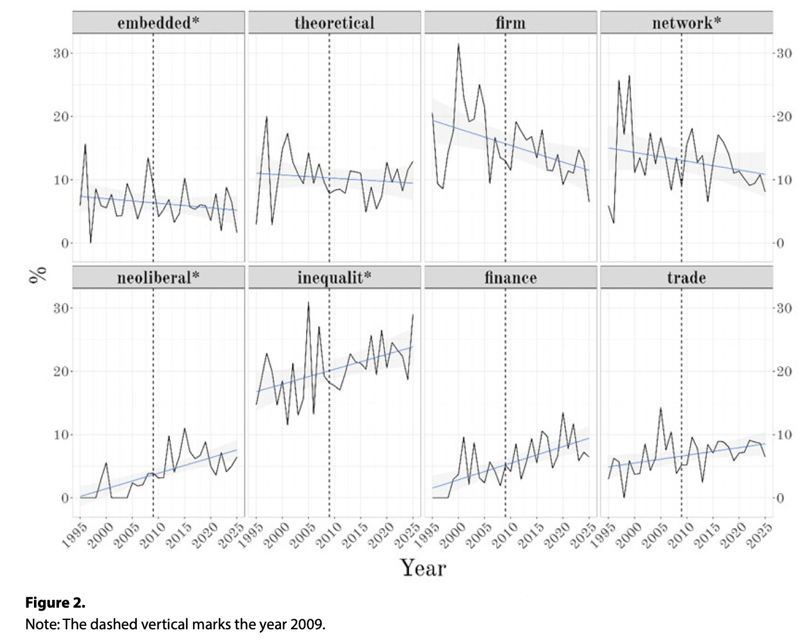

---

##### Download

+ [Full Paper](2026_econsoc.pdf)

---

##### Abstract

This essay grows out of a sense that the sociology of markets, once an intellectual center of gravity in the new economic sociology, no longer occupies the place it used to. In turn, economic sociologists have shifted their attention away from developing sociological takes on the workings of the market to elsewhere. We suspect that most readers share the intuition. The major books have been published, the canonical debates about rational calculation, embeddedness, and the social order of markets have been had, and much of the most exciting work in economic sociology today seems to take its energy from places other than fighting the hegemony of mainstream economics.
---

##### Evolution of keyword frequency in core journals, 1995–2025



---

##### Citation

Ergen, Timur, 2026. What happened to the sociology of markets? Notes on paradigmatic fracture. *economic sociology: perspectives and conversations* 27, 3, 5–15.

```BibTeX
@ARTICLE{Ergen2026econsoc,
  author = {Ergen, Timur and Pilmis, Olivier and Serafin, Marcin},
  date = {2026},
  title = {What happened to the sociology of markets? Notes on paradigmatic fracture},
  journaltitle = {economic sociology: perspectives and conversations},
  volume = {27},
  number = {3},
  pages = {5–15},
  url = {https://econsoc.mpifg.de/52386/02_Ergen-Pilmis-Serafin_Econsoc_27-3_July2026.pdf}}

```

---

